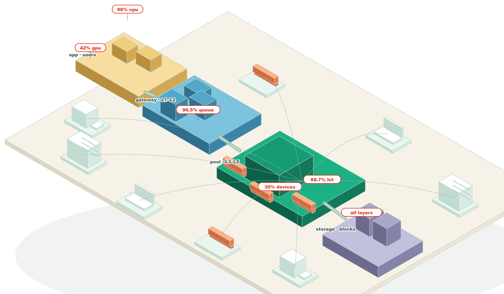
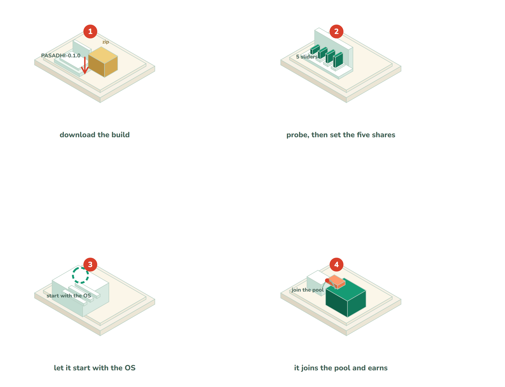

<p align="center"></p>

# PASADHI · ปัสสัทธิ

**A virtual distributed machine for old hardware.** PASADHI turns a room of ageing PCs into one addressable
compute surface — matrix-first, process-layered, and honest about what each generation of CPU can actually do.

> Status: **M0 prototype, v0.1.0 builds shipped.** Kernel and pipeline benchmarks run on one host; the app
> runs on Windows today and from source elsewhere. The distributed plane is specified, not yet implemented.



*The whole system in one isometric view. Red tags are measured shares: 30 % of a machine is the usual
contribution, 88.7 % of prefixes hit the cache, 96.5 % of response time at C=50 is queueing, and the impact
weights are 98 % CPU / 42 % GPU.*



*Installation in four moves — the same four on Windows, Linux, macOS and Android.*

## Why

Cloud GPUs are rented by the hour. Offices already own machines that idle for sixteen hours a day. SUAY proved
the control-plane half of that idea: a token gateway, a node plane, prefix caching, expert routing. PASADHI takes
the half that matters for compute: **the kernel, the pipeline and the scheduler** — and it is not only for LLMs.

## The three ideas

1. **Matrix processor first.** Everything is a matrix operation: dense GEMM, quantised GEMM, block-sparse,
   FFT-as-GEMM, convolution-as-GEMM. One optimised path, many workloads.
2. **Multi-Layer Process.** Work is split into layers (L1 transport, L2 policy, L3 scheduler, L4 kernel,
   L5 storage). Each layer is a process group with its own queue, so a slow layer degrades gracefully instead
   of stalling the machine.
3. **Old hardware is the target, not the excuse.** Haswell-era AVX2, 2–8 GB of usable RAM per box, SATA disks.
   The design budgets for it: int8 before fp32, blocking before threads, streaming before caching.

## Papers

| Paper | What is inside | Download |
|---|---|---|
| **Solution paper** v1.1 · 8 pages | the problem in queueing terms, the three ceilings, the architecture, the four-move install, results, price model, threats to validity | [PASADHI-solution.pdf](https://raw.githubusercontent.com/camponggogo/pasadhi/main/paper/PASADHI-solution-raw.pdf) | 
| **Full paper** · 29 pages · 46 figures | every experiment with its figure and its source file: gateway, ports, queueing, prefix cache, router, experts, fleet, sharding, growth laws, CPU sweep, kernels, GPU fleet, heterogeneous fleet, orbit link budgets, cost, token economy | [PASADHI-full-paper.pdf](https://raw.githubusercontent.com/camponggogo/pasadhi/main/paper/PASADHI-full-raw.pdf) |

Both are rebuilt by `python scripts/build_paper_pdf.py` (in the parent workspace); every figure in the full
paper sits on a white background. The landing page with the same downloads:
[campong.online/projects/pasadhi](https://campong.online/projects/pasadhi/).

## Quick start

### Release downloads · v0.1.0

| OS | Download | Requirements |
|---|---|---|
| Windows x64 | [Standalone app](web/download/PASADHI-0.1.0-windows.zip) | Unzip, run `PASADHI.bat`; Python included |
| Linux | [Python bundle](web/download/PASADHI-0.1.0-linux.tar.gz) | Python 3.10+; run `sh pasadhi.sh` |
| macOS | [Python bundle](web/download/PASADHI-0.1.0-macos.tar.gz) | Python 3.10+; run `sh PASADHI.command` |
| Android | [Termux bundle](web/download/PASADHI-0.1.0-android-termux.zip) | Termux + Python; run `bash pasadhi.sh`; not an APK |
| Source | [Source archive](web/download/PASADHI-0.1.0-source.zip) | Python 3.10+ |

See each archive's `README.txt` for dependency installation. Builds are unsigned.
[SHA-256 checksums](web/download/SHA256SUMS.txt) · [Release manifest](web/download/release.json).
Windows startup is tested using the packaged executable; the Python bundles are startup-tested on Windows.
Native Linux, macOS and Android builds and device testing remain pending.

```bash
python bench/run.py            # kernel + pipeline benchmarks, writes bench/results/*.json
python bench/run.py --quick    # smaller sizes
python app/service.py --port 8765   # the app, then open 127.0.0.1:8765
```

## The app

One service, three roles, one installer. `python app/install.py` probes the machine, scores it, and
picks coordinator / worker / client; the settings page at 127.0.0.1:8765 has five sliders (CPU, GPU, RAM, HDD,
network), a live earnings estimate, the per-install device token and a boot-time autostart switch.

- Design and platform matrix: [docs/APP_SERVICE.th.md](docs/APP_SERVICE.th.md)
- Hardware and per-resource impact (Thai): [docs/RESOURCE_IMPACT.th.md](docs/RESOURCE_IMPACT.th.md)
- Group worker (100–200 machines, one id, internal/shared/hybrid): [docs/GROUP.th.md](docs/GROUP.th.md)
- Payout follows measured impact weights: [docs/IMPACT_PRICING.th.md](docs/IMPACT_PRICING.th.md)

## Layout

```
app/        the service: probe, roles, sliders, device token, autostart
core/       matrix.py, layers.py, gpu.py, hetero.py, orbit.py
bench/      the harness that produces every number in docs/
commercial/ pricing.py, token_model.py
docs/       measured reports (Thai and English)
paper/      SOLUTION.md and SOLUTION_FULL.md, the two papers
web/        isometric scenes: pasadhi-system, pasadhi-install, pool, mesh
```

## Commercial

PASADHI is sold as software and support, not as raw FLOPs — the measurements say why.

| | THB per delivered TFLOP |
|---|---:|
| PASADHI node (60 % duty) | **0.016** |
| Cloud CPU (4 vCPU) | 0.028 |
| Cloud GPU (1× A100) | 0.001 |

We lose to a GPU by 17× on price per FLOP and win against cloud CPU by 1.8×. The product is therefore
**residency, sunk hardware and small bursty jobs**, not a cheaper GPU.

- Business plan, pricing and unit economics (Thai): [`docs/BUSINESS.th.md`](docs/BUSINESS.th.md)
- Sales kit: one-pager, deck outline, objections, quote and SOW (Thai): [`docs/SALES_KIT.th.md`](docs/SALES_KIT.th.md)
- Token economy: credits, layer split and the liquidity reserve (Thai): [`docs/TOKEN_ECONOMY.th.md`](docs/TOKEN_ECONOMY.th.md)
- Public / orbital network: what survives the speed of light (Thai): [`docs/OPEN_NETWORK.th.md`](docs/OPEN_NETWORK.th.md)
- Calculator behind every number: `python commercial/pricing.py`

## GPU layer

Small second-hand cards are a different machine, not a faster node: 1 000 × GTX 1050 2 GB gives
**1.30 PFLOPS f32 (2.60 POPS int8)** for independent jobs, but only **0.16 PFLOPS** if a single GEMM
is sharded across them over 1 GbE — 91.5 % of the card's time would wait for data.

- Design, capacity model and the 1 000-machine reality check: [`docs/GPU_FLEET.md`](docs/GPU_FLEET.md)
- Run the model: `python bench/gpu_model.py`

## Public network

PASADHI is designed to be open to anyone, and eventually to links that are not on this planet. The rule that
survives the speed of light: **the inner loop stays local**. A 4 096³ GEMM sharded over an antipodal fibre link
keeps only **6.9 %** of the card's compute (10 collective rounds × 196 ms); over Earth–Mars it keeps 0.004 %.
Independent 10-minute jobs, by contrast, survive up to the Moon (99.6 %) and only break at Mars (18–62 %).

- Link budgets, DTN design, public-network trust: [`docs/OPEN_NETWORK.th.md`](docs/OPEN_NETWORK.th.md)
- Run it: `python bench/orbit_model.py`

## Mixed fleet

One scheduler from a 2 GB GTX 1050 to a 40 GB A100: 1 450 cards, **9.54 PFLOPS f32 / 47.7 POPS int8** at
143.5 kW. The simulation shows the tail, not the policy, owns the clock — and that splitting a job larger than
any spare card is worth more than buying another one.

- Results and operating notes: [`docs/HETERO_FLEET.md`](docs/HETERO_FLEET.md)
- Run it: `python bench/hetero_model.py`

## Research timeline

Newest first. Every entry names the number that came out of it; the full evidence is the
[full paper](https://campong.online/projects/pasadhi/download/PASADHI-full-paper.pdf).

| Date | Milestone | The number |
|---|---|---|
| 2026-10-23 | Academic solution paper v1.1 + full paper, all figures on white | 29 pages, 46 figures |
| 2026-10-23 | Full-system isometric map with the measured shares in red | 30 / 88.7 / 96.5 / 98 / 42 % |
| 2026-10-23 | Portable build + release workflow for four operating systems | v0.1.0 artifacts |
| 2026-10-23 | Solution paper PDF + six-chapter build story with animated vignettes | 157× cache win retold |
| 2026-10-23 | Isometric pool and mesh scenes deployed | 12 devices, 7 GPUs, 30 links |
| 2026-10-22 23:58 | Isometric explainer animations for the system and its performance | 4 devices, 533 GFLOP/s |
| 2026-10-22 23:45 | Landing page re-themed light and redeployed | cream / mint / coral |
| 2026-10-22 19:37 | Landing page live; vhost installed for pasadhi.tech | HTTP 200 on all pages |
| 2026-10-22 19:23 | Share valuation switched to measured impact weights | CPU 98 %, GPU 42.2 % |
| 2026-10-22 18:57 | Group worker economics for one LAN under one group id | break-even ≈60 % or ฿350/machine |
| 2026-10-22 18:51 | Per-resource impact measured across a CPU sweep | +48.1 % per 10 pp CPU |
| 2026-10-22 18:32 | The app: three roles, five sliders, device token, autostart | 4 OSes, one installer |
| 2026-10-22 16:06 | Public and orbital network design; light speed as the ceiling | fibre 6.9 % → Mars 0.004 % |
| 2026-10-22 16:02 | Token economy model with credits and a 10 % reserve | 68.1 % margin, 43.5 % stressed |
| 2026-10-22 15:48 | Heterogeneous fleet model from 2 GB to 40 GB cards | 9.54 PFLOPS, 143.5 kW |
| 2026-10-22 15:44 | GPU sharing layer modelled for 1 000 small cards | 1.30 PFLOPS vs 0.16 sharded |
| 2026-10-22 15:29 | Commercial layer: pricing, unit economics, sales kit | ฿1,838/machine at 70 % |
| 2026-10-22 15:25 | **PASADHI begins** — M0 baseline measured on real hardware | 58–74 GFLOP/s f32 |
| 2026-10-22 11:40 | The base project's white paper compiled to PDF | 20 pages |
| 2026-10-21 15:01 | Ports extrapolated to 100 | 45 MiB each, no extra req/s |
| 2026-10-21 14:52 | Multi-port and parallel accept measured | 2 ports 26.5 / 28.8 req/s |
| 2026-10-21 14:41 | Gateway ceiling found: the event loop itself | raw loop 58.7–71.2 req/s |
| 2026-10-21 14:28 | Eight complexity classes costed per million calls | ฿1.77–88.66 |
| 2026-10-21 14:15 | Growth laws compared with measured factors | both cap at 15.7 req/s |
| 2026-10-21 14:12 | Best configuration of the base project | 15.0 → 22.3 / 24.8 req/s |
| 2026-10-21 13:56 | PostgreSQL on the hot path tried and rejected | 4.5 req/s with errors |
| 2026-10-21 13:15 | CPU share swept 10 % → 80 % across the fleet | throttle at 100 %: 32.35 GFLOP/s |
| 2026-10-21 12:28 | Prefix cache added and measured | TTFT 111.4 s → 0.71 s (157×) |
| 2026-10-21 04:18 | Map-reduce sharding measured | upload dominates the exchange |
| 2026-10-21 04:00 | Node plane separated from the gateway | heartbeats 44 → 161 req/s |
| 2026-10-21 03:17 | Expert routing by document domain | 90.15 % at 31.5 µs |
| 2026-10-21 02:33 | First empirical scatter of the fleet | 50 containers, 12 req/s |
| 2026-10-21 00:36 | First 50-container Docker fleet measurement | 96.5 % of time was queueing |
| 2026-10-21 00:17 | Token system simulated on the virtual machine | 14 / 14 tests passed |
| 2026-10-20 15:38 | The base project (SUAY) seeded | — |

## Provenance

PASADHI is a fork-in-spirit of [SUAY](https://github.com/camponggogo/suay) (MIT). It keeps SUAY's measurement
discipline — medians, p95, negative results kept in — and replaces the AI-only framing with a general
matrix-compute plane. The 2026-10-20 → 10-21 entries above are that evidence base. Code is MIT; see `LICENSE`.

Named after *ปัสสัทธิ* — calm, settled, at rest. The machine should be quiet and the numbers should be boring.

## Download · release and latest

**Release: v0.1.0 · Latest: v0.1.0.** Versioned links stay fixed; latest links follow the newest published build.
Downloads below are included in this repository and staged for the website; the website update has not been deployed.

| OS | Release v0.1.0 | Latest | How to run |
|---|---|---|---|
| Windows x64 | [Download ZIP](web/download/v0.1.0/PASADHI-0.1.0-windows.zip) | [Latest ZIP](web/download/latest/PASADHI-windows.zip) | Unzip and run `PASADHI.bat`; standalone EXE, Python included |
| Linux | [Download tar.gz](web/download/v0.1.0/PASADHI-0.1.0-linux.tar.gz) | [Latest tar.gz](web/download/latest/PASADHI-linux.tar.gz) | Python 3.10+; `sh pasadhi.sh` |
| macOS | [Download tar.gz](web/download/v0.1.0/PASADHI-0.1.0-macos.tar.gz) | [Latest tar.gz](web/download/latest/PASADHI-macos.tar.gz) | Python 3.10+; `sh PASADHI.command` |
| Android / Termux | [Download ZIP](web/download/v0.1.0/PASADHI-0.1.0-android-termux.zip) | [Latest ZIP](web/download/latest/PASADHI-android-termux.zip) | Termux + Python; `bash pasadhi.sh`; not an APK |
| Source | [Download ZIP](web/download/v0.1.0/PASADHI-0.1.0-source.zip) | [Latest ZIP](web/download/latest/PASADHI-source.zip) | Python 3.10+; instructions in `README.txt` |

[Release checksums](web/download/v0.1.0/SHA256SUMS.txt) · [Latest checksums](web/download/latest/SHA256SUMS.txt) ·
[Release manifest](web/download/v0.1.0/release.json) · [Latest version manifest](web/download/latest/release.json).

The website and White Papers use bundled open-source fonts; see [font licenses](web/fonts/README.md).
